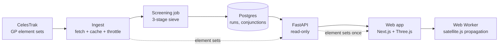

# Architecture

This document fixes the conventions every component agrees on, so the engine, the API and the
visualizer never disagree about frames, units or time. Where the code does not yet match the
target design, that is called out under [Current vs target](#current-vs-target).

## Components

| Component | Responsibility | Status |
|---|---|---|
| Ingest | Pull element sets from CelesTrak, cache each pull with a timestamp, refuse to refetch inside the throttle window | Fetches TLE text each cycle, no cache yet (Oct 6) |
| Screening job | Find close approaches between all tracked objects | Runs inside the API process as a background loop (Oct 13 moves it to a scheduled job) |
| Postgres | Store element sets, screening runs, conjunctions | Not built; state is an in-memory dict (Oct 7) |
| API | Serve results and element sets, read-only | Serves from memory; also has on-demand `/positions` and `/trajectory` |
| Web app | Render orbits and conjunctions, scrub time | Not in this repo yet (Week C) |

The screening job writes; the API only reads. A slow, memory-heavy screening pass must never
run inside a request.

## Reference frames

- **SGP4 output is TEME** (True Equator, Mean Equinox of date). Every position and velocity the
  backend produces is TEME.
- **We stay in TEME end to end and call it ECI in this codebase.** TEME is not J2000: the two
  differ by precession and nutation, about 0.36 degrees in 2026, which is tens of kilometres at
  LEO radius. That is deliberate and safe only because nothing is converted to J2000. TEME is
  also the frame the GMST rotation is defined against, so TEME plus GMST gives the Earth-fixed
  view without any extra step. Never describe these values as J2000, and never mix them with
  J2000 data (for example the Keplerian planet positions in the solar-system view) without an
  explicit rotation.
- **Orbits are drawn in ECI and do not rotate.** The Earth mesh rotates instead.
- **Earth rotation** is the Greenwich Mean Sidereal Time (GMST) angle at the displayed instant,
  applied as a rotation about the +Z axis. Without it, markers drift away from the continents.
- **Axes:** +Z toward the north celestial pole, +X toward the vernal equinox of date, +Y
  completing the right-handed set. Three.js is Y-up, so the web app maps ECI (x, y, z) to
  Three.js (x, z, -y) in exactly one place and nowhere else.
- No polar motion, UT1-UTC or nutation corrections. If a ground-track accuracy claim is ever
  made, it must say so.

## Units

| Quantity | Unit |
|---|---|
| Position | kilometres |
| Velocity, relative speed | kilometres per second |
| Distance, miss distance, altitude | kilometres (altitude above a 6378.135 km Earth radius, the WGS-72 value SGP4 uses) |
| Time of closest approach, all timestamps | UTC, ISO 8601 with an explicit offset (`2026-10-16T23:00:00+00:00`) |
| Time step | seconds |

Naive datetimes are rejected or assumed UTC at the API boundary and never stored. Angles are
radians inside the engine and degrees only in user-facing output.

## Screening pipeline

The naive all-pairs approach is O(n^2) per timestep, roughly 50 million pairs at the size of the
active catalog, and never finishes on free hosting. The pipeline discards impossible pairs
cheaply before any expensive work:

1. **Apogee/perigee filter.** From the elements alone, drop pairs whose altitude bands, padded
   by a margin, do not overlap. A 550 km object can never meet a 35,000 km one.
2. **KD-tree pairs per timestep.** Propagate survivors on a time grid and, at each step, find
   pairs inside a distance threshold with `scipy.spatial.cKDTree.query_pairs`.
3. **TCA refinement.** Between grid steps, minimise separation (Brent) to get the time of
   closest approach, the miss distance and the relative velocity.

Stage 3 output is classified by miss distance, relative speed and element-set age. A pair with
near-zero relative speed is `co-orbiting` (docked or formation flying), not a collision risk;
this is the regression the false-positive fix guards.

## What the numbers mean

A miss distance computed from public element sets is a **screening signal, not a collision
probability**. TLE position error is on the order of kilometres and grows with the age of the
element set. The API and UI report element-set age next to every conjunction, and the product
says "screening", never "prediction".

## Current vs target

| Area | Today | Target |
|---|---|---|
| Element format | TLE text | OMM/JSON (`norad_id` as an integer; TLE cannot hold 6-digit catalog numbers) |
| Screening | Altitude-band filter, then pairwise propagation | Three-stage sieve above |
| Persistence | In-memory dict, lost on restart | Postgres via migrations |
| Execution | Background loop in the API process | Idempotent scheduled job, API read-only |
| Client positions | `/positions` and `/trajectory` computed server-side | Server ships element sets once; browser propagates with satellite.js in a Web Worker |
| Frontend | None in this repo | Next.js + Three.js with a generated, typed API client |
